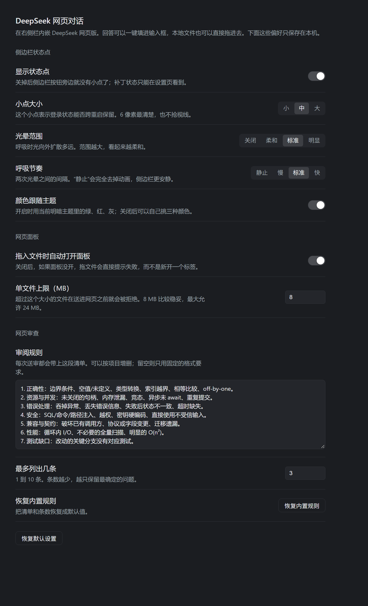

# DeepSeek Web (DSH plugin)

[**简体中文**](README.zh-CN.md) · English

Two controls, one purpose: keep DeepSeek's web chat and your DSH Session in the
same window.

1. **Sidebar launcher** — beside **Settings** at the sidebar foot. Opens
   `https://chat.deepseek.com/` in the shipped right-Sidebar **Browser** tab,
   next to the current Session. Clicking again focuses the tab it already has.
2. **Composer bridge** — a small "pull" control in the composer tool row
   (before Send). One click reads the newest answer out of the DeepSeek panel
   and inserts it into the current draft as one undoable edit, so you can hand
   what the page produced straight to your agent.

The bridge prefers a live text selection inside the DeepSeek page; with nothing
selected it takes the last rendered answer block.

3. **Review tool** — the host half also registers `web_review`, so the agent can
   send a prompt into that same page and get the answer back as structured
   findings. See [Review bridge](#review-bridge).



## Install

This is a **DSH Desktop bundle**, not an npm package. Distribution is the folder
itself.

1. Clone or download this repository somewhere permanent, e.g.
   `C:\plugins\deepseek-web-panel`.
2. Ask your DSH agent to install that directory as a bundle
   (`plugin_manager` → `install_bundle` with the absolute path). The agent adds
   the dependency as a `link:` and the bundle row to your profile, so edits to
   the folder stay live.
3. Restart DSH. The launcher appears at the sidebar foot, beside **Settings**.

Manual alternative: add `"@local/dsh-plugin-deepseek-web": "link:C:/path/to/deepseek-web-panel"`
to your profile's `package.json`, list the package under `dsh.profile.bundles`,
and install; `cordis.patch.yml` is the row this bundle inserts.

### Through a plugin market

This repository also publishes a **market index** (`market.json`, format 1). Add
this URL under **Settings → Plugins → Discover**:

```
https://raw.githubusercontent.com/LuoZIren/dsh-deepseek-web/main/market.json
```

The entry installs this repository as a commit-pinned Git package
(`git+https://github.com/LuoZIren/dsh-deepseek-web.git#<commit>`), so an update
means a new commit and a new version in the index. A market index is just a JSON
file a reader is configured with — there is no central registry to submit to.

Requirements: DSH Desktop (Electron) on Windows, macOS or Linux. The sign-in
patch targets the desktop `app.asar`; a DSH upgrade replaces that file, which the
status dot then reports.

## What it writes to your machine

- The status dot's repair path performs a **50-byte, equal-length rewrite** of a
  single statement inside the desktop `app.asar`, after saving
  `app.asar.orig-bak`. It refuses to write when the archive's shape changed.
  That rewrite is what keeps the DeepSeek sign-in across restarts; without it
  every launch asks you to sign in again.
- Nothing else is written outside your DSH profile. The review bridge types into
  the DeepSeek page you already have open and reads its answer back.

## The status dot

A 6 px dot rides to the right of the launcher and reports whether the partition
patch is in place:

| Dot | Meaning |
|---|---|
| green | the archive carries the persistent statement |
| red | the statement is gone (an upgrade replaced it) — **click the dot** to rewrite it |
| gray | not known yet: open the DeepSeek panel once, or restart DSH |

Clicking a red dot asks the Host half to re-apply the patch; the tooltip then
says a restart is needed, because the running process keeps the partition it was
started with. A dot that stays red with "the archive no longer matches this
patch" means a DSH build changed the statement itself — the plugin refuses to
write rather than risk the archive, and the patch text has to be re-derived.

The dot reads two sources, in order: the Host half's `GET /deepseek-web/patch`
(the archive itself), and the live guest's `partition` attribute (what the
running process actually uses). The second one is what makes the dot correct
before the Host half has been reloaded by a restart.

## Settings

Settings → **DeepSeek web chat** holds this plugin's preferences. They are
stored per browser profile (`dsh.deepseek-web.settings.v1`) and apply live — the
dot on the sidebar updates as you change them, without a reload.

| Group | Preference | What it does |
|---|---|---|
| Status dot | Show the dot | Hides the dot entirely; the launcher stays. |
| | Dot size | 4, 6, or 8 px. |
| | Halo spread | Off / soft / normal / wide — how far the breathing glow reaches. |
| | Breathing rhythm | Still / slow / normal / fast. "Still" removes the animation. |
| | Colours follow the theme | On: green, red and grey come from the active theme. Off: pick three colours. |
| Web panel | Open on drop | Off: a drop with no panel open reports an error instead of opening a tab. |
| | Largest file (MB) | 1–24; files above it are refused before they cross into the page. |
| Web review | Output format | Plain list, JSON with severity, or strict JSON with evidence and confidence. |
| | Review checklist | Sent with every `web_review` request; edit it per project, empty it to keep only the fixed format rules. |
| | Findings at most | 1–10. Fewer findings keeps only the most certain ones. |
| | Built-in checklist | Restores the default checklist and count. |

"Restore defaults" resets every value above. Every preference is written to
local storage, so a fresh install starts from the defaults and a broken stored
value falls back to them.

The default checklist follows the design of Alibaba's open-source
[Open Code Review](https://github.com/alibaba/open-code-review): fixed check
areas (correctness, resources and concurrency, error handling, security,
compatibility, performance, tests) and precision before recall — a finding must
be provable from the shown code, so the model is told to mark uncertainty
instead of guessing. The wording is this plugin's own.

## Drag and drop into the web chat

A bar appears at the top of the frame as soon as a drag can become a file.
**Nothing is sent until the drag is released on that bar** — moving, pressing,
or starting a native drag only announces the candidate, so an accidental
8-pixel drag can never hand a file to the page. Sources, in the order the bridge
tries them:

| Source | What the bridge reads |
|---|---|
| File manager / desktop | the `File` objects of the drag itself |
| Conversation file or delivery card | its accessible description, `title`, `data-*`, `href`, or `src`; a card is an interactive button, so the bridge drags by pointer instead of native drag. A card **header** names no file, so the bridge gathers the distinct paths listed under it — one file for a single-file card, every file for a multi-file card (the bar shows the count before you release) |
| Inline file mention or image | the link address: `dsh-resource://file/…`, `file:///…`, or a relative `href` |
| A reference that only shows a name (`client.js`, `简历.pdf`) | the Host half searches the current session directory by basename (depth 5, skipping `node_modules`, `.git`, `dist`…); a unique match wins, several matches is reported rather than guessed |

The session directory comes from the one visible session. A side-by-side
multi-session layout keeps the last session that published it; a reference that
fails to resolve that way still falls back to the by-name search, so the failure
mode is a refusal rather than a wrong file.

Paths are normalized first: `file:///` URLs, `dsh-resource://file/…` addresses,
`:24` / `:24-30` line anchors, and relative references resolved against the
session directory with that platform's separator. POSIX and Windows forms are
both understood, and a POSIX-shaped string on a Windows session is treated as a
site route rather than a file. A relative reference must look like a path (no
spaces, an extension), and a rooted one is never joined onto the session.

When nothing resolves, the bar says so and copies the pressed element's shape
(tag, class, and its `title`/`href`/`aria-*`) to the clipboard, which is the
fastest way to report a surface the bridge does not recognize yet.

Limits: 8 MB per file (one base64 string crosses into the guest in a single
`executeJavaScript` call, so the payload is capped well below IPC discomfort),
directories are refused, and the page must expose an `input[type=file]` or an
editable drop zone; without either the bar reports the failure instead of
pretending to send.

## Review bridge

The Host half registers a `web_review` Tool: the agent sends a review prompt
(code, a diff, the answer format it wants), and the answer comes back as the
tool result. The page is driven the same way a person would drive it — the
prompt is typed into the composer and Enter is pressed — so no reverse-engineered
API, PoW solver or token refresh is involved.

Flow:

1. the tool queues one request (single flight: a second call while one runs is
   rejected) and awaits the answer;
2. the Client polls `GET /deepseek-web/review/task` every 1.2 s;
3. on a new request it opens a **dedicated DeepSeek tab** (never the
   conversation the user is having), waits for the composer, types, and sends;
4. it polls the page until the answer stops growing (message count or body
   length stops changing, no stop control visible), then extracts the text;
5. it posts the answer to `POST /deepseek-web/review/result`, which resolves the
   waiting tool call.

The message the page receives is composed on the Client: a **fixed block**
(chosen by the Output format preference) followed by the checklist from Settings,
the previous round when one is supplied, and the request the tool sent. The fixed
block is not editable; everything after it is.

### Structured answers, dedupe, re-review

The default format asks for one JSON block:

```json
{"findings":[{"severity":"high|medium|low","problem":"…","reason":"…","fix":"…"}]}
```

The Host parses it (fenced block or bare object/array, English or Chinese keys,
severity words normalized), and the tool returns `findings[]` alongside the raw
`report`; `parsed: false` means the answer was prose and only `report` is usable.

Two behaviours ride on that shape:

- **Dedupe** — the same prompt with the same previous findings returns the cached
  answer (`cached: true`, no page round-trip). `force: true` re-asks anyway.
- **Re-review** — pass `previousFindings: string[]` and the page is asked to
  confirm each one (fixed / still there / changed) before adding new ones.

### The conversation card

A `web_review` call renders through `tool.call.toolview` (keyed by tool name) as
a card instead of a plain text block: one row per finding with its severity, the
reason and the fix, plus a checkbox to tick a finding off once it is handled.
Ticks are stored per call id in local storage, so they survive a reload and stay
with the call they belong to. A run still in flight shows "reviewing…"; a run
whose answer was prose shows the answer text instead of rows.

### Invoking it

The bridge is a Tool, and only an agent can call a Tool — so a review is asked
for in conversation ("use the web chat to review this diff"), not clicked. The
agent may call it more than once in a turn, passing `previousFindings` on the
second call. Nothing starts a review on its own.

Limits: 200 000 characters per prompt, 90 s default wait (300 s maximum), one
review at a time, and the panel must be open and signed in. The prompt leaves
this machine and is visible in that DeepSeek chat — treat it as a second
opinion, not a gate.

Two details the Host half has to get right:

- **The archive must be opened through `original-fs`.** Desktop runs the Host
  under Electron's node, whose `fs` treats every path containing `.asar` as a
  path *inside* an archive. `open('…/app.asar')` therefore becomes "open the
  empty path inside app.asar" and fails with `ENOENT,  not found in
  …app.asar`. `original-fs` is the same module without that layer (verified
  against this build under `ELECTRON_RUN_AS_NODE`), with `process.noAsar` as the
  fallback for a plain-node run.
- **A write needs a token.** `GET` returns a per-process `randomUUID`, and a
  `POST` must carry it in the query (or the `x-dsh-deepseek-web: patch` header),
  so a page from another origin — which cannot read the GET body and does not
  survive a preflight — cannot trigger a rewrite.

## Persistent sign-in: the partition patch

Desktop creates the sidebar browser's storage partition in exactly one place
(`DesktopBrowserGuests.acquire` in the shell's main process):

```js
let partition = this.partitions.get(workspace);
if (partition === void 0) {
  partition = `dsh-sidebar-browser-${randomUUID()}`;
  this.configureSession(session.fromPartition(partition));
  this.partitions.set(workspace, partition);
}
```

A partition name without the `persist:` prefix is an in-memory Electron session,
so cookies and localStorage die with the process: every launch is a brand-new
device, which is both the repeat sign-in and the reason DeepSeek's risk engine
treats the login as new. A plugin cannot change that — `will-attach-webview`
rejects any guest whose partition differs from the lease the main process
issued, and the lease always carries this exact string.

So the fix lives outside the plugin. `tools/apply-persist-patch.mjs` rewrites
that one statement in place, with a replacement of **exactly the same 50 bytes**
so no asar header, offset, or file table changes:

```diff
- partition = `dsh-sidebar-browser-${randomUUID()}`;
+ partition="persist:"+workspace.replace(/\W/g, "");
```

```bash
node tools/apply-persist-patch.mjs --check     # report only
node tools/apply-persist-patch.mjs --apply     # needs the app closed
node tools/apply-persist-patch.mjs --restore   # back to stock
```

`--apply` refuses while DeepSeek Harness runs, keeps one `app.asar.orig-bak`
beside the archive, and reads the bytes back to verify. The app must be closed
because it maps `app.asar`; the script parses the patched method before it
writes, and was dry-run against a copy of the archive first.

**A DSH upgrade replaces `app.asar`, so the patch has to be re-applied after
every upgrade.** The status dot is the reminder: it turns red, and one click on
it runs the same rewrite from the Host process (no terminal, no closed app — the
archive is writable while the app runs; the new bytes take effect on the next
launch).

The rewrite itself is a fixed procedure, not a per-build judgement call: one
byte-for-byte substitution of a known 50-byte statement. Only if a DSH build
changes that statement does the patch need re-deriving, and every path refuses
to write in that case — the script exits non-zero, the dot reports "the archive
no longer matches this patch", and the app is left untouched.

Effects to know about:

- The partition becomes `persist:<workspace without punctuation>`, so the cookie
  jar is written under the app's `Partitions` directory — sign in once, and the
  session survives restarts. The sign-in is a stable device from then on.
- This is the whole sidebar browser, not just DeepSeek: every site opened in that
  panel now keeps its cookies on disk.
- The name is sanitized with `\W`, so a workspace path made only of punctuation
  collapses, and two very long paths that differ only after 200+ characters
  could share a jar.
- A revoked or expired DeepSeek session still asks for one sign-in.

## Why DeepSeek said "abnormal usage environment"

DeepSeek's own client ships a hard-coded check:

```js
navigator.userAgent.toLowerCase().includes('electron')
  || ('process' in window && window.process.type === 'renderer')
```

Either hit renders the `usageEnvUnsafeTitle` / `usageEnvUnsafeWarn` dialog
("使用环境异常 … 建议您使用我们的官方产品"). In this guest `process` is not
exposed (`sandbox`, `contextIsolation`, no node), so the user agent is the only
trigger. The plugin calls `webview.setUserAgent()` once per tab with the same
string minus the `Electron/x.y.z` and application tokens — platform and Chromium
version untouched — and reloads, so the check no longer fires and the sign-in
request no longer advertises an embedded browser.

The dialog is dismissible and its "closed" flag is persisted storage, so once the
partition survives restarts, a dismissed dialog stays dismissed too.

## Why it reuses the Browser tab

`chat.deepseek.com` answers with `content-security-policy: frame-ancestors
'none'`, so a plain `<iframe>` page inside DSH cannot load it. The shipped
Browser tab type is the supported way around that: on Desktop it embeds a real
Electron guest view (not a frame), which a site cannot refuse. The bridge then
reads that guest through `webview.executeJavaScript()`; the guest keeps
`sandbox`, `contextIsolation`, and `nodeIntegration: false`, so nothing is
injected into the page and no Node access is granted.

In the browser build of DSH the same tab type falls back to an iframe and no
guest exists, so both controls report that embedded browsing is unavailable
instead of failing silently.

## Extension points

| Piece | Where |
|---|---|
| Launcher | Client slot `sidebar.footer.action`, cell id `deepseek-web` |
| Navigation | `ctx.sidebarRight.openTab('browser', { params: { url } })` |
| Bridge | Client slot `conversation.input.right`, cell id `deepseek-web-pull` |
| Insertion | `inputActions.captureInsertion()` + `inputActions.insertText(text, span)` |
| Styling | One `style[data-plugin-css]` tag using `--dsw-*` tokens; focus ring on `:focus-visible` only |
| Host half | empty `apply()`; the capability is entirely browser-side |

## Known limits

- Sign-in persistence needs the main-process partition patch described above;
  the plugin alone cannot keep cookies across restarts.
- Without a Session on screen the right Sidebar has no surface, so the launcher
  reports that instead of opening an empty panel.
- The guest's user agent is normalized to a plain Chrome string (see above). A
  server that cross-checks User-Agent against client hints could notice the
  mismatch; DeepSeek's shipped client reads only the agent string.
- The bridge reads the guest's rendered text by shape (`[class*="markdown"]`),
  not by a DeepSeek API. If the site reworks its markup, the shape fallback
  chain degrades to the last message-like block; a manual selection always
  works and is checked first.
- The client half hot-reloads in this Desktop build: saving `client.js`
  re-applies the module and replaces its slot registrations in place.
- Requires the `ui-sidebar-browser` row, which the Desktop profile enables by
  default.
