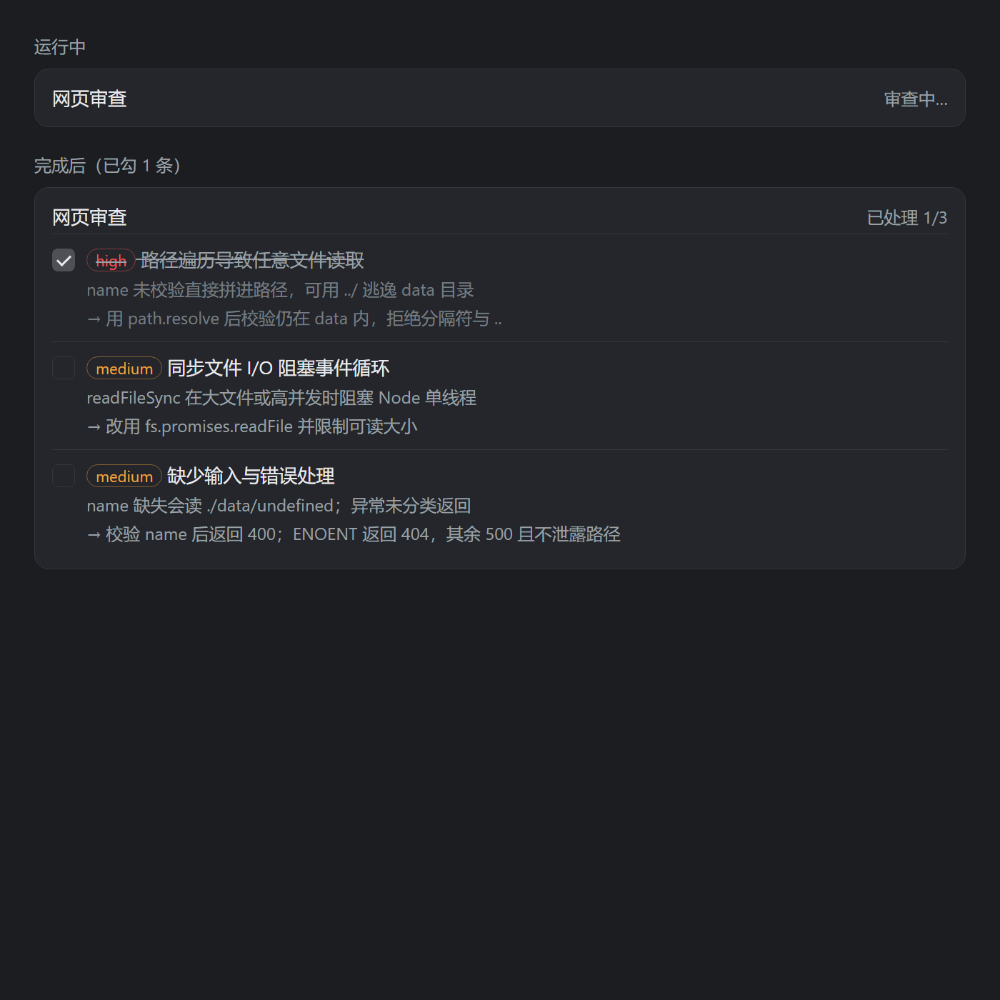

# DeepSeek 网页对话（DSH 插件）

简体中文 · [English](README.md)

把 **chat.deepseek.com** 装进 DSH 的右侧栏，让网页对话和你的会话待在同一个窗口里：回答可以一键填进输入框，本地文件可以拖进去，网页本身还能当成一个"外聘代码审查员"。


## 它做了什么

| 能力 | 说明 |
|---|---|
| **侧边栏入口** | 在侧边栏底部、**设置**旁边。单击打开 `https://chat.deepseek.com/`（复用内置 Browser 标签），再点一次只聚焦已开的标签；双击再开一个新的 |
| **拉取回答** | 输入框工具栏（发送按钮左侧）的小按钮。一键把网页里最新一条回答填进当前草稿，算一次可撤销的编辑；网页里选中文字时只取选区 |
| **拖拽送文件** | 拖到屏幕顶部出现的投放条上松手，文件就会被送进网页的上传框 |
| **网页审查** | 向 Agent 注册 `web_review` 工具：把审查请求发给这个页面，拿回结构化的问题清单 |

## 安装

这是一个 **DSH Desktop 的 bundle**，不是 npm 包，分发方式就是仓库本身。

1. 把仓库克隆/下载到一个长期保留的位置，例如 `C:\plugins\deepseek-web-panel`；
2. 让你的 DSH Agent 把这个目录安装成 bundle（`plugin_manager` → `install_bundle`，传绝对路径）。它会把依赖写成 `link:`，所以之后改动文件夹里的代码会立即生效；
3. 重启 DSH。侧边栏底部就会出现入口。

手动等价操作：在 profile 的 `package.json` 里加
`"@local/dsh-plugin-deepseek-web": "link:C:/path/to/deepseek-web-panel"`，把包名写进
`dsh.profile.bundles`，再安装。`cordis.patch.yml` 就是这个 bundle 要插入的那一行。

环境要求：DSH Desktop（Electron），Windows / macOS / Linux。登录态补丁针对桌面版
`app.asar`；DSH 升级会替换这个文件，状态点会提示。

## 它会往你机器上写什么

- 状态点的"修复"动作会对桌面版 `app.asar` 里**一条语句做 50 字节、等长的改写**，改前先存 `app.asar.orig-bak`。如果发现该语句的结构变了，它会拒绝写入。这条改写是"登录态跨重启保留"的关键；没有它，每次启动都要重新登录。
- 除此之外不写 DSH profile 以外的东西。审查功能只是在你已经打开的 DeepSeek 页面里输入文字、读回回答。

## 状态点

入口右边有个 6px 的小点：

| 颜色 | 含义 |
|---|---|
| 绿 | 归档里带着持久化语句，登录能跨重启保留 |
| 红 | 语句没了（升级被替换）—— **点它**重写，然后重启 |
| 灰 | 还没确定：打开一次面板或重启 DSH |

红点一直红、提示"归档不再匹配"时，说明某个 DSH 版本改动了那条语句本身。插件会拒绝写入而不是冒险改坏归档，这时需要重新适配补丁文本。

## 设置

**设置 → DeepSeek 网页对话**，存在本机浏览器 profile 里（`dsh.deepseek-web.settings.v1`），改完即时生效，状态点会立刻跟着变。

| 分组 | 设置项 | 作用 |
|---|---|---|
| 侧边栏状态点 | 显示状态点 | 关掉后只剩入口按钮 |
| | 小点大小 | 4 / 6 / 8 像素 |
| | 光晕范围 | 关闭 / 柔和 / 标准 / 明显 |
| | 呼吸节奏 | 静止 / 慢 / 标准 / 快（"静止"完全去掉动画） |
| | 颜色跟随主题 | 关掉后可自选三种状态的颜色 |
| 网页面板 | 拖入文件时自动打开面板 | 关掉后，面板没开时拖文件会直接报错，不再新开标签 |
| | 单文件上限 | 1–24 MB，超限在送进网页前就拒绝 |
| 网页审查 | 输出格式 | 清单 / JSON（带严重级别）/ 严格 JSON（带证据与置信度） |
| | 审阅规则 | 每次送审都会带上；留空则只用固定格式要求 |
| | 最多列出几条 | 1–10 |
| | 恢复内置规则 | 还原默认清单与条数 |

## 拖拽送文件

只要一次拖拽可能变成文件，屏幕顶部就会出现投放条。**松手落在投放条上才会发送** —— 移动、按下、开始原生拖拽都只是"预告"，8 像素的误拖不会把文件送出去。

| 来源 | 读取什么 |
|---|---|
| 文件管理器 / 桌面 | 拖拽自带的 `File` 对象 |
| 会话里的文件卡片、交付卡片 | 它的 `aria` 描述、`title`、`data-*`、`href`、`src`；卡片本身是交互按钮，所以用指针拖拽代替原生拖拽。卡片头不指向具体文件，会把这张卡片列出的文件全部收集（多个时投放条会显示数量） |
| 行内文件链接、图片 | `dsh-resource://file/…`、`file:///…` 或相对 `href` |
| 只显示名字的引用（如 `client.js`） | 在会话目录里按文件名查找（深度 5，跳过 `node_modules`、`.git`、`dist`…）；唯一命中才发送，多个同名会明说而不是乱猜 |

路径会先归一化：`file:///`、`dsh-resource://file/…`、`:24` / `:24-30` 行号锚点，相对路径按会话目录拼接。包含 `..` 的相对引用、以分隔符开头的引用都会被拒绝。

都解析不出来时，投放条会说明原因，并把被按元素的形态（标签、class、`title`/`href`/`aria-*`）复制到剪贴板。

## 网页审查（`web_review`）

Host 半边注册了一个工具：Agent 把审查请求发过去，结果作为工具返回值拿回来。页面是像人一样被驱动的 —— 打字、点发送、读回答 —— 没有逆向接口、没有 PoW、不需要刷新 token。

流程：

1. 工具入队一个请求（单飞：同时只跑一个），等待回答；
2. 客户端每秒轮询一次任务；
3. 有新请求时打开**专用标签**（不会动你正在聊的会话），等输入框就绪，写入并发送；
4. 轮询页面直到回答不再增长（没有停止按钮、消息数/正文长度稳定），然后只取页面标记为答案的那一块；
5. 把回答回传，等待中的工具调用随即返回。

默认输出格式要求一个 JSON 块：

```json
{"findings":[{"severity":"high|medium|low","problem":"…","reason":"…","fix":"…"}]}
```

Host 负责解析（围栏或裸对象/数组、中英文键名、严重级别归一化），工具返回 `findings[]` 和原始 `report`；`parsed: false` 表示这次回答是散文，只有 `report` 可用。

两个基于这个结构的行为：

- **去重**：同一个 prompt + 同一批上一轮结论 → 直接返回缓存（`cached: true`，不再动页面）；`force: true` 强制重审；
- **重审**：传 `previousFindings: string[]`，页面会逐条确认（已修复 / 仍存在 / 已有变化），再补充新问题。

每次调用的卡片：



一条问题一行，带严重级别、原因、改法，以及一个复选框；勾选状态按调用 id 存在本地，刷新不丢。

限制：单次 prompt 最多 20 万字符，默认等 90 秒（最多 300 秒），同时只能跑一个，面板必须已打开并登录。**内容会发到 DeepSeek 的服务器**，当"第二意见"用，不要当门禁。

## 登录态补丁

DSH 每次启动都给 Sidebar Browser 生成一个**内存里**的存储分区（`dsh-sidebar-browser-<uuid>`），所以网页的 cookie 活不过一次重启。插件对桌面版归档里那条语句做等长改写，让它变成按工作区持久化的 `persist:` 分区。

- 改写只有 50 字节、长度不变，改前存 `.orig-bak`；
- 结构不匹配就拒绝写；
- 升级后归档被替换 → 状态点变红 → 点一下重写 → 重启生效。

## 为什么 DeepSeek 会提示"使用环境异常"

页面能读到 `navigator.userAgent`，而 Electron 会在里面写上 `Electron/x.y.z`。插件会在页面就绪后把它换成不含 Electron / 应用名的 UA，必要时重载一次页面（页面里有草稿时会等下次导航再换，不丢你输入的内容）。

## 复用 Browser 标签的原因

`chat.deepseek.com` 会发 `content-security-policy: frame-ancestors 'none'`，任何 iframe 都装不下它。内置 Browser 标签用的是真正的 `<webview>`，是唯一能显示站点的位置。

## 已知限制

- DeepSeek 页面一改版，审查链路的 DOM 定位（输入框、发送控件、答案块）可能失效；失败时错误信息里会带诊断快照，便于重新定位；
- 会话目录取自"当前可见会话"，并排多会话时会用最后发布的那个；解析不到相对路径时会退化为按文件名查找，行为是拒绝而不是读错文件；
- 多开几个 DeepSeek 标签且都不可见时，拖拽和拉取会拒绝猜测目标。

## 开发

```powershell
# 语法检查（无依赖，用 DSH 自带的 node）
node --check index.js
node --check client.js

# 打发布包
powershell -ExecutionPolicy Bypass -File tools\pack.ps1
```

发布到 GitHub（需要先 `gh auth login`）：

```powershell
powershell -ExecutionPolicy Bypass -File tools\github-publish.ps1 -RepoName dsh-deepseek-web
```

更多技术细节（补丁字节、路由契约、实现取舍）见 [英文 README](README.md)。

## 许可证

MIT。
